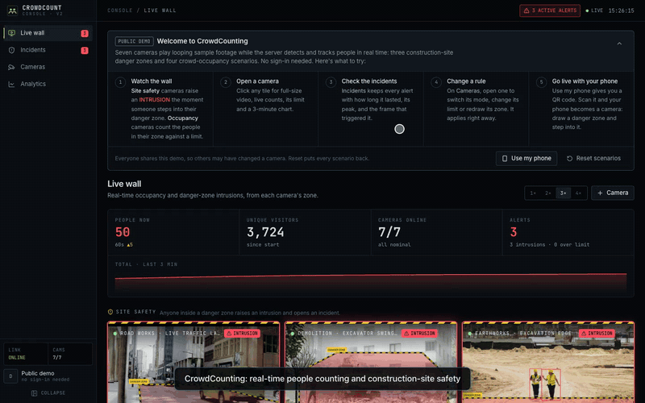
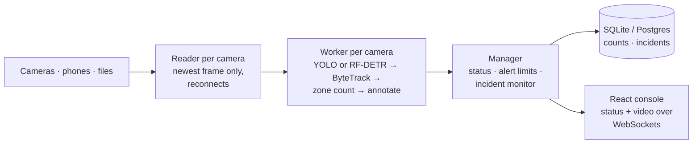

# Zonewatch

Real-time people counting and construction-site safety on live camera feeds. Draw a zone on
any camera, and Zonewatch tells you how many people are inside it, how many distinct
people have passed through, and the moment someone enters an area they must not be in. Every
alert is kept as an incident with the frame that triggered it.

[](docs/media/demo.mp4)

▶ **[Watch the full 70-second walkthrough](docs/media/demo.mp4)**: the welcome guide, danger-zone
intrusions, occupancy limits, an incident with its snapshot, and changing a rule live.

## What it does

- **Occupancy:** count people inside a polygon zone on each camera, against a capacity
  limit. Distinct visitors are counted once each, by tracking, not once per frame.
- **Danger zones:** the same zones with a stricter rule: anyone inside is an
  **intrusion**. Made for exclusion zones such as an excavator's swing radius, a live traffic
  lane, or an excavation edge.
- **Incidents:** alerts become debounced incidents, each with its start, end, peak and the
  annotated frame that triggered it, so one false detection or a brief occlusion doesn't
  count.
- **Any camera:** RTSP, RTMP, SRT, HLS and MJPEG streams, snapshot-only cameras, USB webcams,
  video files, and any phone or laptop through a link, with no app. ONVIF discovery and
  brand URL templates help find a camera's stream.
- **Live console and analytics:** annotated live video for every camera, alerts, and
  per-minute history over up to 30 days.
- **Public demo mode:** opens straight onto seven scenarios with no login, safe to put on a
  public URL.

## How it works



One Python process runs a thread per camera, all sharing one detector on the GPU. Each worker
detects people, tracks them, and counts those whose feet are inside the zone. The manager
turns counts into alerts and debounced incidents, and the console receives status and video
over two WebSockets. Every handoff keeps only the newest frame, so a slow camera or viewer
gets fewer frames but never falls behind real time. The full design is in
[System design](docs/architecture/README.md).

## Quick start

Requirements: Python 3.12–3.13 with [uv](https://docs.astral.sh/uv/), and Node 22+.

```bash
cd backend
uv sync --extra yolo
ZW_DEMO_MODE=true ZW_DETECTOR_IMGSZ=1280 ZW_CONFIDENCE=0.3 uv run uvicorn app.main:app --port 8000
```

```bash
cd frontend && npm install && npm run dev      # → http://localhost:5173
```

In demo mode the server downloads the sample footage on first start, and the scenarios
appear on the live wall over a minute or two. Leave out `ZW_DEMO_MODE` to run it normally,
with accounts and your own cameras. More in [Getting started](docs/getting-started.md),
including Docker and using a phone as a camera.

## Documentation

| | |
|---|---|
| **Guides** | [Getting started](docs/getting-started.md) · [User guide](docs/user-guide.md) · [Camera sources](docs/camera-sources.md) · [The demo](docs/demo.md) |
| **Reference** | [Configuration](docs/configuration.md) · [API](docs/api.md) · [Development](docs/development.md) |
| **System design** | [Overview](docs/architecture/README.md) · [Frame pipeline](docs/architecture/frame-pipeline.md) · [Counting](docs/architecture/counting.md) · [Alerts and incidents](docs/architecture/alerts-and-incidents.md) · [Live video](docs/architecture/live-video.md) · [Data model](docs/architecture/data-model.md) · [Performance](docs/architecture/performance.md) · [Failure modes](docs/architecture/reliability.md) · [Security](docs/architecture/security.md) · [Observability](docs/architecture/observability.md) · [Scaling](docs/architecture/scaling.md) |
| **Decisions** | [Architecture decision records](docs/adr/README.md) |
| **AWS** | [Overview](docs/aws/README.md) · [Deploying](docs/aws/deploy.md) · [Cost](docs/aws/cost.md) · [Monitoring](docs/aws/monitoring.md) · [CI/CD](docs/aws/ci-cd.md) · [Security](docs/aws/security.md) · [Path to production](docs/aws/production.md) |

All of it is indexed in [docs/](docs/README.md).

## Tech stack

| | |
|---|---|
| Backend | Python 3.12, FastAPI, SQLAlchemy 2 + Alembic (SQLite or Postgres), PyAV/FFmpeg, OpenCV |
| Vision | [Ultralytics YOLO26](https://docs.ultralytics.com) or [RF-DETR](https://github.com/roboflow/rf-detr), [ByteTrack](https://github.com/roboflow/trackers), [supervision](https://github.com/roboflow/supervision) |
| Frontend | React 19, TypeScript, Vite, Tailwind 4, TanStack Query, Recharts |
| Infrastructure | Docker Compose; AWS CDK (EC2 GPU, CloudFront, WAF, CloudWatch), GitHub Actions with OIDC |
| Quality | pytest against real RTSP/HLS/MJPEG test servers, Vitest, ruff, ESLint, cdk-nag |

## Repository

```
backend/    FastAPI app: API, camera pipeline (app/vision/), demo scenarios, metrics
frontend/   React console
infra/      AWS CDK app: the demo stack and the GitHub deploy roles
docs/       guides, reference, system design, decision records, AWS deployment
```

A detailed layout is in [Development](docs/development.md#repository-layout).

## Licensing note

Ultralytics YOLO is **AGPL-3.0**: running it in a network service obliges you to publish your
source, unless you hold an Ultralytics enterprise license. RF-DETR is **Apache-2.0**; set
`ZW_DETECTOR=rfdetr` if that matters for your deployment.

## Credits

Originally built as an undergraduate project at M.H. Saboo Siddik College of Engineering,
Mumbai (Dept. of Information Technology) by **Mubin Modi, Zaid Marouf and Anvay Wankhede**,
supervised by **Dr. Shabina Sayed**. Version 2 is a full rewrite on a modern stack; the
original write-up and what changed are in [docs/original-project.md](docs/original-project.md).

Demo footage: Pexels videos 7259509, 38817827 and 8964933, and Roboflow's supervision example
videos.
