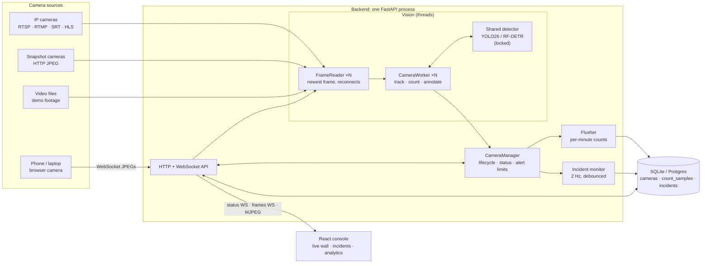
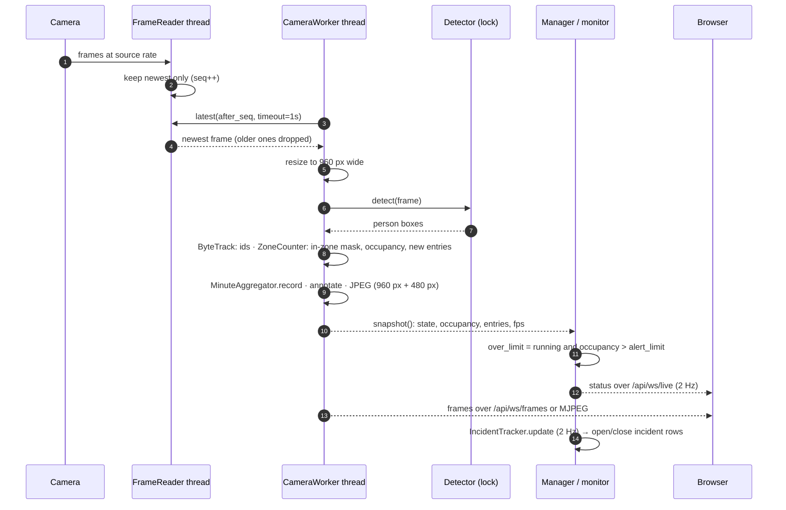
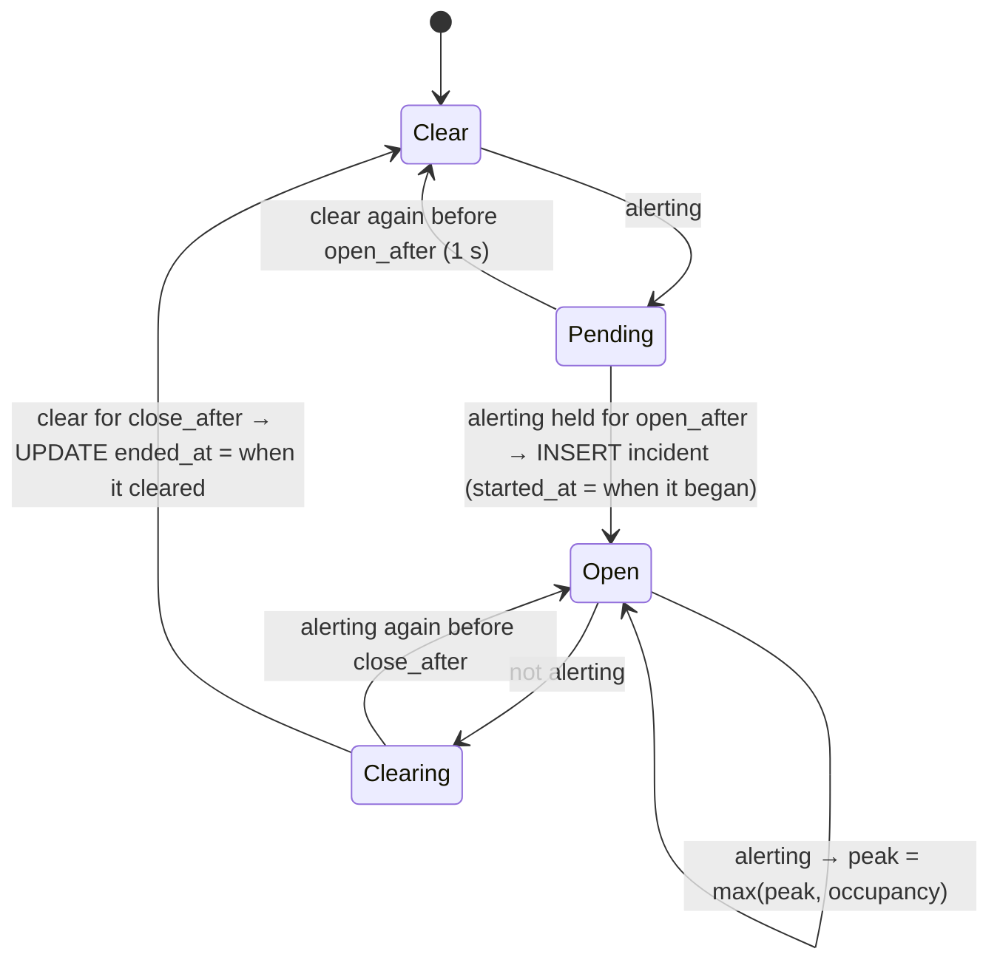
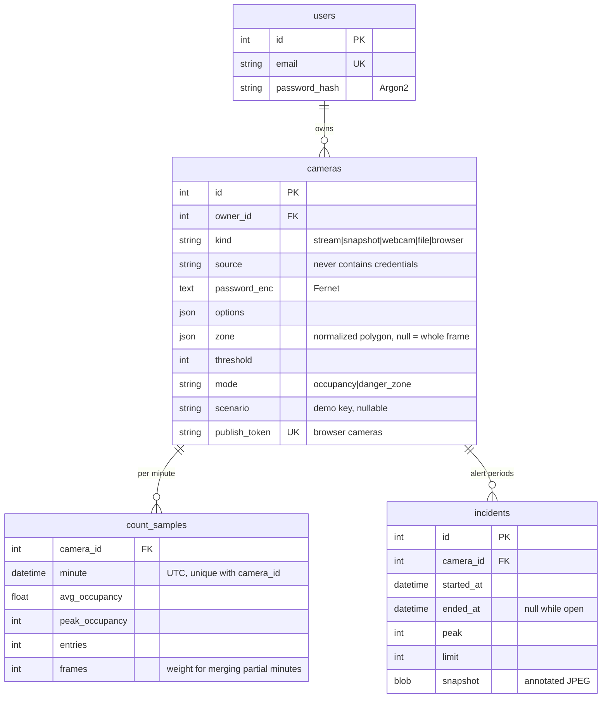
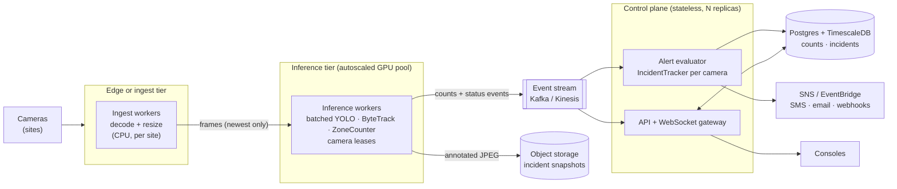

# System design

CrowdCounting turns live camera feeds into two kinds of signal:

- **Occupancy:** how many people are inside an area right now, and how many distinct people
  have passed through it. Used for capacity limits, staffing and footfall analytics.
- **Safety:** whether anyone is inside an area they must not be in (an excavator's swing
  radius, a live traffic lane, an open excavation). Used for construction-site exclusion zones.

Both are the same computation: detect people, track them across frames, test whether each
person's feet are inside a polygon, then compare the count against a limit. The two modes
differ only in the limit's default, how the result is drawn, and how alerts are debounced.

This document covers the design as built (one node), the reasoning behind it, measured
performance, failure handling, security, and how it would scale past one node. The decisions
are recorded individually in [`adr/`](adr/). Deployment is in
[deployment-aws.md](deployment-aws.md), and how to present the demo is in [demo.md](demo.md).

## Contents

1. [Requirements](#requirements)
2. [Architecture](#architecture)
3. [The frame pipeline](#the-frame-pipeline)
4. [Concurrency model](#concurrency-model)
5. [Zones, tracking and counting](#zones-tracking-and-counting)
6. [Alerts and incidents](#alerts-and-incidents)
7. [Live delivery to browsers](#live-delivery-to-browsers)
8. [Data model and storage](#data-model-and-storage)
9. [API surface](#api-surface)
10. [Performance and capacity](#performance-and-capacity)
11. [Failure modes](#failure-modes)
12. [Security](#security)
13. [Observability](#observability)
14. [Scaling beyond one node](#scaling-beyond-one-node)
15. [Known limitations](#known-limitations)

## Requirements

**Functional**

| # | Requirement |
|---|---|
| F1 | Ingest any common camera source: RTSP/RTMP/SRT/HLS/MJPEG streams, snapshot-only cameras, USB webcams, video files, and a phone or laptop camera with no app installed. |
| F2 | Count people inside a user-drawn polygon per camera, so overlapping cameras don't double-count. |
| F3 | Count distinct people who enter the zone (unique visitors or intrusions), not people per frame. |
| F4 | Two camera modes: **occupancy** (alert above N people) and **danger zone** (alert when anyone is inside, or more than an allowed N). |
| F5 | Keep an **incident log**: when each alert started and ended, its peak, and the frame that triggered it. |
| F6 | Live dashboard: annotated video, counts and alerts with under a second of delay. |
| F7 | Historical analytics: occupancy and entries per minute, viewable from 1 hour to 90 days. |
| F8 | A public **demo mode** with no login and safe defaults. |

**Non-functional**

| Quality | Target | How it's met |
|---|---|---|
| Latency | Alerts show in the UI within about 1 s of the event | Newest-frame-wins reading (no queues), 2 Hz status push, 1 s incident debounce |
| Throughput | 10–15 FPS per camera on one GPU for a handful of cameras | One shared model, a per-camera FPS cap, frames downscaled before inference |
| Resilience | A bad camera never affects the others; dropped streams recover by themselves | A thread per camera, timeouts on every read, reconnects with exponential backoff |
| Freshness over completeness | A slow consumer gets fewer frames, never stale ones | Every handoff keeps only the latest item |
| Privacy | Footage is not stored | Only counts and one annotated JPEG per incident are kept |
| Cost | A demo is cheap to run and to stop | One instance; stream size and FPS caps; [deployment-aws.md](deployment-aws.md#cost-estimate) |

## Architecture

### Modules

| Module | Owns | Interface |
|---|---|---|
| `vision/sources/*` | Opening each kind of source, decoding, mapping failures to actionable error codes | `open_source(spec) -> FrameSource`, `probe(spec) -> ProbeResult` |
| `vision/sources/reader.py` | One thread per camera that always holds the newest frame and reconnects with backoff | `latest(after_seq, timeout)`, `health` |
| `vision/detectors/*` | Person detection behind one interface, with three adapters (Ultralytics, RF-DETR, a fake for tests) | `detect(frame) -> sv.Detections` |
| `vision/counter.py` | Zone membership by foot position; unique entries per track | `update(detections, frame_wh) -> ZoneResult` |
| `vision/worker.py` | The per-camera pipeline: resize, detect, track, count, record, annotate, encode | `snapshot() -> CameraSnapshot`, `latest_jpeg(small)` |
| `vision/alerts.py` | When a camera is alerting, and how alerts become incidents. Pure logic. | `alert_limit(mode, threshold)`, `IncidentTracker.update(now, alerting, occupancy)` |
| `vision/manager.py` | Worker lifecycle, the shared detector, alert limits, count persistence, the incident monitor | `upsert(camera)`, `remove(id)`, `status(id)` |
| `api/*` | HTTP/WebSocket adapters: auth, ownership checks, demo-mode rules | REST + 3 WebSockets ([API surface](#api-surface)) |
| `demo.py` | Demo scenarios: footage download/trim, seeding, reset | `seed()`, `reset_scenarios()` |

The detector and source seams each have several real adapters, so they're real seams, not
speculative ones. `alerts.py` has no I/O at all, so its rules are tested directly against a
fake clock ([`tests/test_alerts.py`](../backend/tests/test_alerts.py)).

## The frame pipeline

At every stage only the newest item survives. The reader overwrites its single slot, the
worker skips frames it didn't get to, and both video outputs send the latest JPEG rather than
a queue. A camera slower than its source shows a lower FPS but never falls behind real time,
which is the property that matters for safety alerts.

The worker caps itself at `CC_MAX_FPS` (default 15) and reports the rate it actually achieves
as an exponential moving average, which the UI shows per camera.

## Concurrency model

The backend is one process. Inference is CPU/GPU bound and releases the GIL inside PyTorch, so
threads are enough at this scale, and they keep frames in shared memory with no serialization.

| Thread | Count | Does | Shares through |
|---|---|---|---|
| `reader:<id>` | 1 per camera | Decode the source, keep the newest frame, reconnect with backoff | `Condition` + sequence number; `health` replaced as one tuple |
| `camera:<id>` | 1 per camera | The pipeline above | `_out_lock` guards JPEGs and counts; `snapshot()` reads under it |
| detector | shared | Inference | One `Lock` serializes calls: neither backend is thread-safe, and on one GPU it's about as fast as running in parallel |
| `flusher` | 1 | Every 60 s, drain completed minutes into `count_samples` | `MinuteAggregator` has its own lock |
| `incidents` | 1 | At 2 Hz, sample every camera's status and record incident transitions | Reads `manager.status()`; keeps its own tracker state |
| `demo-seed` | 1, demo only | Download/trim footage and create scenario cameras as each becomes ready | Calls `manager.upsert` |
| asyncio loop | 1 | HTTP, the three WebSockets, MJPEG | Reads snapshots and JPEGs; blocking DB work goes through `asyncio.to_thread` |

There are two consistency rules. A status snapshot is taken in one pass under the worker's
output lock, together with one read of the reader's `health` tuple, so a state can never be
paired with an error from another moment. And alert limits live in the manager, not in the
worker's config, so changing a limit can't restart a worker ([ADR 0003](adr/0003-alert-limits-outside-the-pipeline.md)).

## Zones, tracking and counting

- **Normalized polygons.** Zones are stored in `[0, 1]` coordinates and turned into pixels per
  frame size, so they survive resolution changes and sub-stream switches.
- **Feet, not boxes.** A person counts when the bottom-centre of their box (where they stand) is
  inside the polygon. Requiring the whole box to be inside, as v1 did, misses anyone partly
  out of frame, and using the box centre counts people whose heads overlap an area.
- **Tracking.** ByteTrack gives each person a persistent id. Occupancy is per frame, but
  *entries* count each id once, the first time it's seen inside the zone. Ids unseen for 300
  frames are forgotten, so the memory used stays bounded.
- **One model, two meanings.** In occupancy mode entries are unique visitors. In danger-zone
  mode they are people who entered the zone, which the UI labels "Entered".

## Alerts and incidents

**Alert rule** (`alert_limit`): an occupancy camera alerts above its threshold, and only if one is
set. A danger zone alerts above its threshold, which defaults to **0**, so one person is an
intrusion. Raising it allows authorized people, such as a banksman. A camera only alerts while
it's `running`; after a disconnect its last count is stale.

**Incidents** turn a noisy per-frame flag into events with a start and an end. The
`IncidentTracker` is debounced in both directions:

| Setting | Danger zone | Occupancy | Why they differ |
|---|---|---|---|
| `open_after` | 1 s | 1 s | A one-frame false detection is not an intrusion |
| `close_after` | 3 s | 15 s | Intrusions should stay separate. Occupancy hovers around its limit, and one busy spell should be one incident, not dozens |

Timestamps record when the condition actually began and cleared, not when the debounce
finished. Each incident stores the annotated JPEG at the moment it opened (about 30–90 KB),
and only the newest 200 per camera are kept. When the server restarts, incidents left open
are closed at their start time, so they don't claim a duration nobody observed.

The monitor samples at 2 Hz in the manager instead of inside each worker. That keeps the frame
pipeline free of database writes and puts every alert decision in one testable place. Because
the monitor is the single source of alert events, a notifier (email, SMS, a webhook) hooks in
there, at one point ([ADR 0004](adr/0004-incidents-debounced-state-machine.md)).

## Live delivery to browsers

| Channel | Carries | Rate | Used by |
|---|---|---|---|
| `GET /api/ws/live` (WebSocket) | Every camera's status: state, counts, FPS, alert, errors | 2 Hz | Every page |
| `GET /api/ws/frames` (WebSocket, binary) | Every camera's newest 480 px JPEG, each prefixed with a 4-byte camera id | `CC_STREAM_FPS` | Live wall tiles |
| `GET /api/cameras/{id}/stream.mjpg` | One camera's 960 px MJPEG | `CC_STREAM_FPS` | Enlarged view, embeds |

The wall used to be one MJPEG `` per tile. Over HTTP/1.1 (Vite's dev proxy, plain
nginx) a browser allows **6 connections per host**, and MJPEG responses never end, so a
seven-camera wall used them all and every later request (API calls, page loads) hung.
Multiplexing all tiles over one WebSocket removes the limit and is also cheaper: tiles get
480 px frames, a quarter to a third of the bytes of the full stream (measured below). Frames
are handed to `` elements directly through object URLs, not React state, so a wall at
8 FPS doesn't re-render the page 50 times a second ([ADR 0005](adr/0005-live-video-delivery.md)).

## Data model and storage

- **Counts are aggregated in memory and written once a minute**, never per frame. Twenty
  cameras at 15 FPS is 300 frames a second but only 20 rows a minute. A restarted worker can
  write the same minute twice; rows merge, weighted by frame count.
- **Analytics** sums cameras per minute and then buckets the result (1 min to 6 h, picked
  from the range), so the combined view reports total people across cameras.
- **SQLite** in WAL mode by default (readers don't block the flusher), or Postgres with one
  setting. The schema is migrated with Alembic on startup.

## API surface

| Method & path | Purpose |
|---|---|
| `GET /api/config` | `demo_mode` and the detector name, read before anything else |
| `POST /api/auth/{signup,login,logout}`, `GET /api/auth/me` | Sessions in httpOnly cookies. In demo mode `me` is always the shared demo user |
| `GET/POST /api/cameras`, `GET/PATCH/DELETE /api/cameras/{id}` | Camera CRUD. Changing the source, zone or mode restarts the worker; changing the name or limit doesn't |
| `POST /api/cameras/probe` | Connect once and report resolution, codec, time to first frame and a preview, or an error code with a hint |
| `GET /api/cameras/{id}/status` | The same snapshot the live socket sends |
| `GET /api/cameras/{id}/snapshot.jpg` · `stream.mjpg[?size=small]` | A raw frame for the zone editor, and live MJPEG |
| `GET /api/incidents[?camera_id]` · `GET /api/incidents/{id}/snapshot.jpg` | Incident log, newest first, and the frame that triggered each one |
| `GET /api/analytics?hours=&camera_id=&bucket_minutes=` | Bucketed occupancy and entries, plus a summary |
| `POST /api/demo/reset` | Restore every scenario camera's zone, mode and limit |
| `WS /api/ws/live` · `WS /api/ws/frames` · `WS /api/publish/{token}` | Status push, multiplexed tile frames, and phone publishing (authorized by token) |

Every camera-scoped route checks ownership and returns **404, not 403**, for other users'
cameras, so their ids can't be discovered.

## Performance and capacity

Measured on an Apple M-series Mac (PyTorch on MPS) with the seven demo scenarios:

| Measurement | Value |
|---|---|
| YOLO26n inference, one 960×540 frame at `imgsz` 640 / 1280 | ~13–20 ms / ~30–40 ms |
| People found in the plaza scenario, `imgsz` 640 → 1280 (conf 0.25) | 5 → 52 |
| Processing rate, 7 cameras sharing the detector at `imgsz` 1280 | 3–6 FPS per camera |
| Full 960 px MJPEG at ~4.5 FPS | 266–1666 KB/s per camera (60–350 KB per frame; the cobblestone plaza is the worst) |
| Small 480 px tile stream at ~4.5 FPS | 92–443 KB/s per camera, **~3.5× less** |
| 8 concurrent API calls with the live wall open | 93 ms in total |

**Capacity model.** The shared detector is the bottleneck, and it is serialized, so the total
work is roughly *cameras × FPS × inference time ≤ 1 s per second*. With the Mac's ~35 ms at
1280, that's about 28 inferences per second, or 4 FPS each across 7 cameras, which matches
what was measured. A T4 runs YOLO26n at 1280 in an estimated 8–12 ms in FP32 PyTorch
(not measured here), so 80–120 inferences per second: 7 cameras at 11–15 FPS. Exporting the
model to TensorRT FP16 typically gives another 2–3×. The knobs, in order of leverage:
`CC_DETECTOR_IMGSZ` (cost grows with the square of the size; 640 is enough except for distant
crowds), `CC_MAX_FPS` (counting doesn't need 15 FPS; 5 is usually plenty), and the model size.

**Bandwidth model.** For each viewer, the wall costs the sum of the cameras' small-stream rates
at `CC_STREAM_FPS`. For the demo at 8 FPS that's about 2 MB/s, or 7 GB per hour of viewing.
The enlarged view adds one full stream. Through CloudFront that's the dominant running cost
after the instance itself ([estimate](deployment-aws.md#cost-estimate)).

## Failure modes

| Failure | Effect | Handling |
|---|---|---|
| Camera unreachable, wrong password, wrong path | That camera only | Classified into `auth`, `not_found`, `unreachable`, `timeout` and others with a hint; reconnects with exponential backoff (2 s → 30 s); shown in the camera's stream health |
| Stream stalls without closing | Would freeze the worker | Read timeout (8 s), then reconnect. A worker never waits on a source for more than 1 s without checking for a stop |
| Decoder throws mid-stream | That camera, briefly | The reader closes the source, classifies the error and reconnects with backoff; `reconnects` goes up in stream health |
| Inference error (e.g. GPU out of memory) | One frame | Caught; the worker backs off 1 s and retries |
| Camera offline while alerting | Stale count | `over_limit` requires `state == running`, so an alert can't stick on a disconnected camera |
| Process restart | In-memory counts for the current minute; open incidents | The minute in progress is flushed on clean shutdown. Open incidents are closed at their start time on the next boot |
| Slow browser | That viewer | Newest-frame-only sending: it gets fewer frames, never a growing buffer |
| Phone publisher disconnects or a second device takes over | That camera | Status shows `waiting` with a hint; the new device takes over the slot (generation counter) |
| Instance or host failure (AWS) | Everything | CloudWatch status-check alarms reboot it, or stop/start it onto new hardware ([details](deployment-aws.md)) |

## Security

- **Accounts.** Argon2id password hashes; signed, expiring session tokens in httpOnly
  SameSite=Lax cookies (Secure behind HTTPS); constant-time login for unknown emails.
- **Tenant isolation.** Every query is scoped to the owner; other users' ids return 404.
- **Camera credentials** are kept out of URLs, encrypted at rest (Fernet, key derived from
  `CC_SECRET_KEY`), never returned to the browser, and only put back into the URL at the moment
  FFmpeg connects.
- **Server-side request forgery is the main risk.** Any camera source is opened *by the
  server*, so in a multi-user or public deployment a user could point one at
  `http://169.254.169.254/` (cloud metadata), an internal service or a local file. That's
  acceptable for a self-hosted tool where every user is trusted, but not on a public URL.
  **Demo mode** therefore only allows push sources: visitors can add phone cameras, which send
  frames *to* the server, while stream/snapshot/file/webcam sources, **Test connection** on
  them, and ONVIF discovery all return 403. Scenario cameras can be edited and reset but not
  deleted or given a new source, and phone cameras are capped (default 4).
  [ADR 0006](adr/0006-public-demo-mode.md) covers the threat model.
- **Publish tokens** act like RTMP stream keys: 192-bit random, rotatable, and only valid for
  browser cameras.
- **AWS.** No SSH, IMDSv2 only, the security group only admits CloudFront, and the secret
  lives in Secrets Manager ([security model](deployment-aws.md#security-model)).

## Observability

What exists: per-camera stream health in the UI (state, error code and hint, resolution,
codec, achieved FPS, reconnect count), structured logs for reconnects and failures,
`GET /api/health` (used by the AWS boot health gate), and the incident log itself.

What production would add: Prometheus metrics (per-camera FPS, inference latency histogram,
detector lock wait time, reconnects, WebSocket clients, flush latency) with alerts on "camera
FPS = 0 for 5 min" and "lock wait > 50% of the frame budget". OpenTelemetry traces would show
where a slow frame spent its time.

## Scaling beyond one node

The single process is deliberate for a handful of cameras: no broker, no serialization, one
thing to deploy. Its limits are clear. The detector lock caps total throughput at one
accelerator, all workers fail together, and the API shares a process with the inference.
The path past that keeps the modules and moves the seams onto the network:

- **Decode near the cameras.** Shipping raw RTSP to a central GPU costs more bandwidth than
  shipping resized frames, and an edge box keeps working when the WAN drops. Each site's
  ingest worker sends only the newest frame per camera.
- **Batch inference and lease cameras.** Inference workers hold time-limited leases on cameras
  (for example via Postgres advisory locks or a coordination service), so each camera has
  exactly one owner and a dead worker's cameras move once its lease expires. Batching frames
  across cameras into one GPU call removes today's serialized lock. ByteTrack state is per
  camera, so it lives with the lease.
- **Events, not polling.** Workers publish per-frame status to a stream. The alert evaluator,
  today's `IncidentTracker` unchanged, consumes it and writes incidents. The WebSocket gateway
  fans status out to consoles, and notifications fire from the one place that decides alerts.
- **Time-series storage.** `count_samples` becomes a TimescaleDB hypertable with continuous
  aggregates for hourly and daily rollups, plus a retention policy. Snapshots move to S3 with a
  lifecycle rule.
- **Rough sizing for 1,000 cameras at 5 FPS:** 5,000 inferences per second. With a TensorRT
  FP16 YOLO26n at 640 (an estimated ~1.5 ms batched on an A10G-class GPU), that's about 8 GPUs
  with headroom. The event stream carries about 5,000 small messages per second, and the
  database ingests about 17 rows a second (per-minute samples). Bandwidth, not compute, then
  dominates for sites with poor uplinks, which is another argument for decoding at the edge.

## Known limitations

- **Unique counts are per track, not per identity.** Someone who leaves the frame and comes
  back gets a new id. Cross-camera re-identification is out of scope.
- **Zone membership uses the 2D foot point,** so a person standing just behind a zone on screen
  can look inside it in a low-angle shot. Higher camera angles avoid this.
- **Detection quality limits everything.** Small distant people need a larger inference size
  (the plaza scenario), and heavy occlusion undercounts dense crowds; for those, density-map
  models estimate counts better than detectors.
- **Looping demo footage** produces an incident every loop, which is realistic per loop but
  makes incident counts larger than a real site would see.
- **One process** means one failure domain; see [Scaling beyond one node](#scaling-beyond-one-node).
