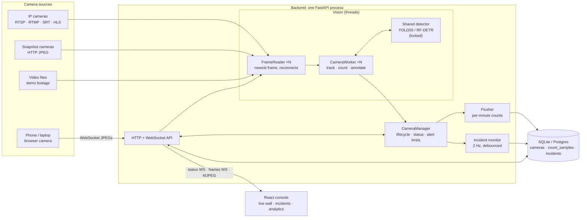

# System design

Zonewatch turns live camera feeds into two kinds of signal:

- **Occupancy:** how many people are inside an area right now, and how many distinct people
  have passed through it. Used for capacity limits, staffing and footfall analytics.
- **Safety:** whether anyone is inside an area they must not be in (an excavator's swing
  radius, a live traffic lane, an open excavation). Used for construction-site exclusion zones.

Both are the same computation: detect people, track them across frames, test whether each
person's feet are inside a polygon, then compare the count against a limit. The two modes
differ only in the limit's default, how the result is drawn, and how alerts are debounced.

This page gives the requirements and the big picture. Each topic below has its own page, the
decisions behind the design are recorded one by one in [`adr/`](../adr/), and the AWS
deployment is documented in [`aws/`](../aws/).

## Topics

| Page | Covers |
|---|---|
| [The frame pipeline](frame-pipeline.md) | How a frame flows from camera to browser, and which thread owns what. |
| [Zones, tracking and counting](counting.md) | Normalized polygons, foot position, tracker ids and unique entries. |
| [Alerts and incidents](alerts-and-incidents.md) | The alert rule per mode and the debounced incident state machine. |
| [Live video delivery](live-video.md) | Status socket, multiplexed frames socket, MJPEG, and the video cost controls. |
| [Data model and storage](data-model.md) | Tables, per-minute aggregation, analytics bucketing, migrations. |
| [Performance and capacity](performance.md) | Measured numbers, the capacity model, and the tuning knobs. |
| [Failure modes](reliability.md) | What breaks, what it affects, and how the system recovers. |
| [Security](security.md) | Accounts, tenant isolation, credentials, SSRF and the demo-mode threat model. |
| [Observability](observability.md) | Stream health, EMF metrics, logs and alarms. |
| [Scaling beyond one node](scaling.md) | The multi-node design: edge ingest, a GPU pool with camera leases, events. |
| [API reference](../api.md) | Every endpoint and WebSocket protocol |

## Requirements

**Functional**

| # | Requirement |
|---|---|
| F1 | Ingest any common camera source: RTSP/RTMP/SRT/HLS/MJPEG streams, snapshot-only cameras, USB webcams, video files, and a phone or laptop camera with no app installed. |
| F2 | Count people inside a user-drawn polygon per camera, so overlapping cameras don't double-count. |
| F3 | Count distinct people who enter the zone (unique visitors or intrusions), not people per frame. |
| F4 | Two camera modes: **occupancy** (alert above N people) and **danger zone** (alert when anyone is inside, or more than an allowed N). |
| F5 | Keep an **incident log**: when each alert started and ended, its peak, and the frame that triggered it. |
| F6 | Live dashboard: annotated video, counts and alerts with under a second of delay. |
| F7 | Historical analytics: occupancy and entries per minute, viewable from 1 hour to 90 days. |
| F8 | A public **demo mode** with no login and safe defaults. |

**Non-functional**

| Quality | Target | How it's met |
|---|---|---|
| Latency | Alerts show in the UI within about 1 s of the event | Newest-frame-wins reading (no queues), 2 Hz status push, 1 s incident debounce |
| Throughput | 10–15 FPS per camera on one GPU for a handful of cameras | One shared model, a per-camera FPS cap, frames downscaled before inference |
| Resilience | A bad camera never affects the others; dropped streams recover by themselves | A thread per camera, timeouts on every read, reconnects with exponential backoff |
| Freshness over completeness | A slow consumer gets fewer frames, never stale ones | Every handoff keeps only the latest item |
| Privacy | Footage is not stored | Only counts and one annotated JPEG per incident are kept |
| Cost | A demo is cheap to run and to stop | One instance; stream size and FPS caps; [deployment-aws.md](../aws/cost.md#cost-estimate) |

## Architecture

### Modules

| Module | Owns | Interface |
|---|---|---|
| `vision/sources/*` | Opening each kind of source, decoding, mapping failures to actionable error codes | `open_source(spec) -> FrameSource`, `probe(spec) -> ProbeResult` |
| `vision/sources/reader.py` | One thread per camera that always holds the newest frame and reconnects with backoff | `latest(after_seq, timeout)`, `health` |
| `vision/detectors/*` | Person detection behind one interface, with three adapters (Ultralytics, RF-DETR, a fake for tests) | `detect(frame) -> sv.Detections` |
| `vision/counter.py` | Zone membership by foot position; unique entries per track | `update(detections, frame_wh) -> ZoneResult` |
| `vision/worker.py` | The per-camera pipeline: resize, detect, track, count, record, annotate, encode | `snapshot() -> CameraSnapshot`, `latest_jpeg(small)` |
| `vision/alerts.py` | When a camera is alerting, and how alerts become incidents. Pure logic. | `alert_limit(mode, threshold)`, `IncidentTracker.update(now, alerting, occupancy)` |
| `vision/manager.py` | Worker lifecycle, the shared detector, alert limits, count persistence, the incident monitor | `upsert(camera)`, `remove(id)`, `status(id)` |
| `api/*` | HTTP/WebSocket adapters: auth, ownership checks, demo-mode rules | REST + 3 WebSockets ([API surface](../api.md)) |
| `demo.py` | Demo scenarios: footage download/trim, seeding, reset | `seed()`, `reset_scenarios()` |

The detector and source seams each have several real adapters, so they're real seams, not
speculative ones. `alerts.py` has no I/O at all, so its rules are tested directly against a
fake clock ([`tests/test_alerts.py`](../../backend/tests/test_alerts.py)).

## Known limitations

- **Unique counts are per track, not per identity.** Someone who leaves the frame and comes
  back gets a new id. Cross-camera re-identification is out of scope.
- **Zone membership uses the 2D foot point,** so a person standing just behind a zone on screen
  can look inside it in a low-angle shot. Higher camera angles avoid this.
- **Detection quality limits everything.** Small distant people need a larger inference size
  (the plaza scenario), and heavy occlusion undercounts dense crowds; for those, density-map
  models estimate counts better than detectors.
- **Looping demo footage** produces an incident every loop, which is realistic per loop but
  makes incident counts larger than a real site would see.
- **One process** means one failure domain; see [Scaling beyond one node](scaling.md).
