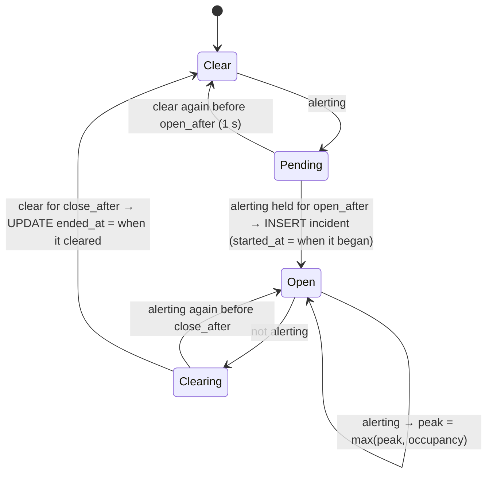

# Alerts and incidents

**Alert rule** (`alert_limit`): an occupancy camera alerts above its threshold, and only if one is
set. A danger zone alerts above its threshold, which defaults to **0**, so one person is an
intrusion. Raising it allows authorized people, such as a banksman. A camera only alerts while
it's `running`; after a disconnect its last count is stale.

**Incidents** turn a noisy per-frame flag into events with a start and an end. The
`IncidentTracker` is debounced in both directions:

| Setting | Danger zone | Occupancy | Why they differ |
|---|---|---|---|
| `open_after` | 1 s | 1 s | A one-frame false detection is not an intrusion |
| `close_after` | 3 s | 15 s | Intrusions should stay separate. Occupancy hovers around its limit, and one busy spell should be one incident, not dozens |

Timestamps record when the condition actually began and cleared, not when the debounce
finished. Each incident stores the annotated JPEG at the moment it opened (about 30–90 KB),
and only the newest 200 per camera are kept. When the server restarts, incidents left open
are closed at their start time, so they don't claim a duration nobody observed.

The monitor samples at 2 Hz in the manager instead of inside each worker. That keeps the frame
pipeline free of database writes and puts every alert decision in one testable place. Because
the monitor is the single source of alert events, a notifier (email, SMS, a webhook) hooks in
there, at one point ([ADR 0004](../adr/0004-incidents-debounced-state-machine.md)).

---

Part of the [system design](README.md) documentation.
