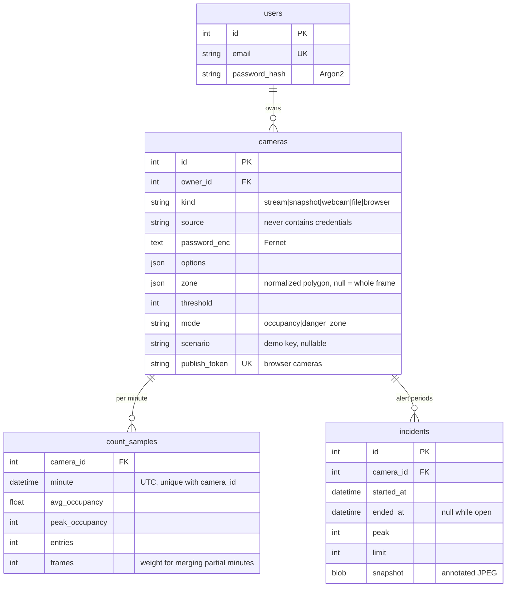

# Data model and storage

- **Counts are aggregated in memory and written once a minute**, never per frame. Twenty
  cameras at 15 FPS is 300 frames a second but only 20 rows a minute. A restarted worker can
  write the same minute twice; rows merge, weighted by frame count.
- **Analytics** sums cameras per minute and then buckets the result (1 min to 6 h, picked
  from the range), so the combined view reports total people across cameras.
- **SQLite** in WAL mode by default (readers don't block the flusher), or Postgres with one
  setting. The schema is migrated with Alembic on startup.

---

Part of the [system design](README.md) documentation.
