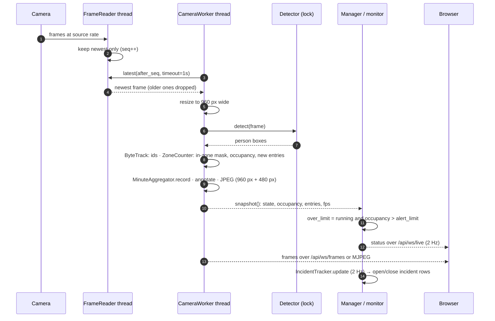

# The frame pipeline

At every stage only the newest item survives. The reader overwrites its single slot, the
worker skips frames it didn't get to, and both video outputs send the latest JPEG rather than
a queue. A camera slower than its source shows a lower FPS but never falls behind real time,
which is the property that matters for safety alerts.

The worker caps itself at `CC_MAX_FPS` (default 15) and reports the rate it actually achieves
as an exponential moving average, which the UI shows per camera.

## Concurrency model

The backend is one process. Inference is CPU/GPU bound and releases the GIL inside PyTorch, so
threads are enough at this scale, and they keep frames in shared memory with no serialization.

| Thread | Count | Does | Shares through |
|---|---|---|---|
| `reader:<id>` | 1 per camera | Decode the source, keep the newest frame, reconnect with backoff | `Condition` + sequence number; `health` replaced as one tuple |
| `camera:<id>` | 1 per camera | The pipeline above | `_out_lock` guards JPEGs and counts; `snapshot()` reads under it |
| detector | shared | Inference | One `Lock` serializes calls: neither backend is thread-safe, and on one GPU it's about as fast as running in parallel |
| `flusher` | 1 | Every 60 s, drain completed minutes into `count_samples` | `MinuteAggregator` has its own lock |
| `incidents` | 1 | At 2 Hz, sample every camera's status and record incident transitions | Reads `manager.status()`; keeps its own tracker state |
| `demo-seed` | 1, demo only | Download/trim footage and create scenario cameras as each becomes ready | Calls `manager.upsert` |
| asyncio loop | 1 | HTTP, the three WebSockets, MJPEG | Reads snapshots and JPEGs; blocking DB work goes through `asyncio.to_thread` |

There are two consistency rules. A status snapshot is taken in one pass under the worker's
output lock, together with one read of the reader's `health` tuple, so a state can never be
paired with an error from another moment. And alert limits live in the manager, not in the
worker's config, so changing a limit can't restart a worker ([ADR 0003](../adr/0003-alert-limits-outside-the-pipeline.md)).

---

Part of the [system design](README.md) documentation.
