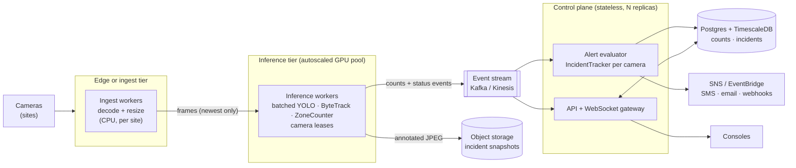

# Scaling beyond one node

The single process is deliberate for a handful of cameras: no broker, no serialization, one
thing to deploy. Its limits are clear. The detector lock caps total throughput at one
accelerator, all workers fail together, and the API shares a process with the inference.
The path past that keeps the modules and moves the seams onto the network:

- **Decode near the cameras.** Shipping raw RTSP to a central GPU costs more bandwidth than
  shipping resized frames, and an edge box keeps working when the WAN drops. Each site's
  ingest worker sends only the newest frame per camera.
- **Batch inference and lease cameras.** Inference workers hold time-limited leases on cameras
  (for example via Postgres advisory locks or a coordination service), so each camera has
  exactly one owner and a dead worker's cameras move once its lease expires. Batching frames
  across cameras into one GPU call removes today's serialized lock. ByteTrack state is per
  camera, so it lives with the lease.
- **Events, not polling.** Workers publish per-frame status to a stream. The alert evaluator,
  today's `IncidentTracker` unchanged, consumes it and writes incidents. The WebSocket gateway
  fans status out to consoles, and notifications fire from the one place that decides alerts.
- **Time-series storage.** `count_samples` becomes a TimescaleDB hypertable with continuous
  aggregates for hourly and daily rollups, plus a retention policy. Snapshots move to S3 with a
  lifecycle rule.
- **Rough sizing for 1,000 cameras at 5 FPS:** 5,000 inferences per second. With a TensorRT
  FP16 YOLO26n at 640 (an estimated ~1.5 ms batched on an A10G-class GPU), that's about 8 GPUs
  with headroom. The event stream carries about 5,000 small messages per second, and the
  database ingests about 17 rows a second (per-minute samples). Bandwidth, not compute, then
  dominates for sites with poor uplinks, which is another argument for decoding at the edge.

---

Part of the [system design](README.md) documentation.
