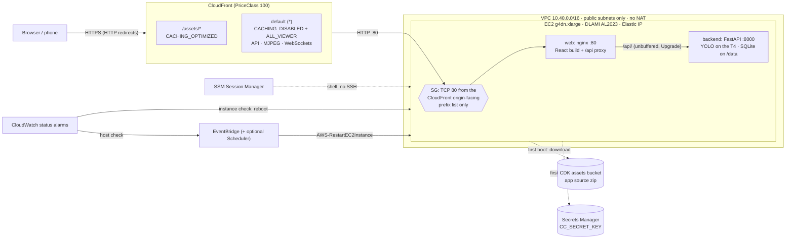

# Deploying the public demo to AWS

This deploys CrowdCounting as a public, no-login demo on one NVIDIA GPU instance behind
CloudFront. It's an AWS CDK v2 app in Python under [`infra/`](../../infra), managed with `uv`.
Viewers get HTTPS on the default `*.cloudfront.net` domain, which is enough for live MJPEG
video, WebSockets, and publishing from a phone camera (browsers only allow camera access on
secure origins).

- **Region:** us-east-1
- **Compute:** one `g4dn.xlarge` (4 vCPU, 16 GiB, 1x NVIDIA T4 16 GB), x86_64
- **Cost:** about $415/month running 24/7, or about $270/month with the optional nightly
  stop. See [Cost](cost.md).

## Pages

| Page | Covers |
|---|---|
| [Deploying and operating](deploy.md) | Prerequisites, first deploy, options, the boot sequence, operating, updating, teardown. |
| [Cost](cost.md) | Monthly estimate and the controls that keep a public link's cost bounded. |
| [Monitoring and alerts](monitoring.md) | Metrics, alarms and the dashboard. |
| [Continuous deployment](ci-cd.md) | GitHub Actions with OIDC roles and a manual approval. |
| [Security model](security.md) | How the deployment is locked down, and the cdk-nag record. |
| [Path to production](production.md) | What changes beyond a single-instance demo. |

## Architecture

### Request path

1. The viewer opens `https://<id>.cloudfront.net`. Plain HTTP gets a redirect to HTTPS.
2. CloudFront terminates TLS with its default certificate and picks a behavior:
   - `/assets/*` (Vite's content-hashed JS/CSS) is cached at the edge (`CACHING_OPTIMIZED`,
     compressed).
   - Everything else (`index.html`, `/api/*` JSON, the MJPEG streams under `/api/`, and the
     `/api/ws/live` and `/api/publish/<token>` WebSockets) uses `CACHING_DISABLED` with the
     `ALL_VIEWER` origin request policy, so all headers, cookies, query strings and methods
     reach the origin untouched. CloudFront passes WebSocket upgrades through on any
     behavior.
3. CloudFront connects to the origin over **HTTP on port 80**, using the Elastic IP's EC2
   public DNS name (`ec2-a-b-c-d.compute-1.amazonaws.com`). The origin read timeout is 60 s,
   the most allowed without a quota increase. It limits the gap between bytes, not how long
   a response lasts, so continuous MJPEG and WebSocket traffic is fine.
4. The instance's security group only admits TCP 80 from the AWS-managed prefix list
   `com.amazonaws.global.cloudfront.origin-facing`. Nothing else can reach the instance.
5. On the instance, the `web` container (nginx, published on host port 80 by
   `docker-compose.gpu.yml`) serves the React build and proxies `/api/` to
   `backend:8000`. Buffering is off, which MJPEG needs, and `Upgrade` headers are passed
   through for WebSockets.
6. The `backend` container (FastAPI with Ultralytics YOLO on the T4) runs one inference
   thread per camera and stores data in SQLite on the `data` Docker volume.

The backend keeps per-camera worker threads and in-memory state, so it runs as exactly one
instance by design. See [Path to production](production.md) for how to scale it out.

## Resources and why each one exists

All resources are tagged `Project=CrowdCounting`.

| Resource | Why |
|---|---|
| **VPC**, 2 public /24 subnets (2 AZs), internet gateway, **no NAT gateway** | The instance needs a public IP for outbound traffic (image builds, model weights, demo videos, SSM). A NAT gateway would cost about $33/month for nothing. The default security group is stripped of all rules. |
| **Custom resource** (`AwsCustomResource` → `EC2:DescribeManagedPrefixLists`) | Looks up the CloudFront origin-facing prefix-list id at deploy time. The id differs per account, and a synth-time lookup would need AWS credentials. Runs on a small CDK-managed Lambda function. |
| **Security group** | Inbound: TCP 80 from the CloudFront prefix list only. No port 22. Outbound: all. A prefix-list reference counts as its maximum size (about 55 entries) against the 60-rules-per-group quota, so it has to be the only inbound rule. |
| **EC2 instance** `g4dn.xlarge` | The AWS Deep Learning Base OSS NVIDIA Driver GPU AMI (Amazon Linux 2023), with the NVIDIA driver, Docker and nvidia-container-toolkit preinstalled. CloudFormation resolves the AMI at deploy time from the SSM parameter `/aws/service/deeplearning/ami/x86_64/base-oss-nvidia-driver-gpu-amazon-linux-2023/latest/ami-id`. 100 GB gp3 encrypted root volume (the CUDA build of the backend image alone is several GB). IMDSv2 required, with a hop limit of 1. No key pair. |
| **IAM role + instance profile** | `AmazonSSMManagedInstanceCore` for Session Manager, read access to the app-source asset, and read access to the one secret. |
| **Elastic IP** | A stable origin. An instance's own public IP changes on every stop/start and replacement, and CloudFront needs a fixed DNS name. The EIP is moved to a new instance only after the new instance reports healthy. |
| **S3 asset** (in the CDK bootstrap bucket) | The repo's `backend/`, `frontend/` and `docker-compose*.yml`, zipped by `cdk deploy`. This means no container registry and no push to GitHub. Excluded: `.git`, `node_modules`, `.venv`, `infra/`, `docs/`, local databases, `data/`, `models/`, tests, and the local dev TLS key. |
| **Secrets Manager secret** | A random 64-character `CC_SECRET_KEY`, read once by the instance at first boot. |
| **CloudFront distribution** | HTTPS for viewers (needed for phone cameras), edge caching for static assets, and a single public entry point, so the instance itself is never directly reachable. PriceClass 100 covers North America and Europe edges. |
| **CloudWatch Logs** group `/crowdcounting/demo` (14 days) | Both containers log there through Docker's `awslogs` driver (`docker-compose.aws.yml`). The backend's metric lines arrive the same way. The instance role can only write streams in this one group. |
| **SNS topic** `Alerts` (TLS-only) | Every alarm (on alarm and on recovery) and the budget notify it. `-c crowdcounting:alertEmail=you@example.com` subscribes an email; confirm the subscription email AWS sends. |
| **4 app alarms** | On the backend's own metrics. See [Monitoring and alerts](monitoring.md). |
| **CloudWatch dashboard** `CrowdCounting` | Cameras, detector load, viewers, per-camera FPS and occupancy, CloudFront egress, and recent errors. The `DashboardUrl` output links to it. |
| **AWS WAF web ACL** (CloudFront scope) | A per-IP rate limit (429 above 2,000 requests per 5 minutes), plus AWS's IP-reputation and known-bad-inputs rule groups. See [Cost and abuse controls](cost.md#cost-and-abuse-controls). |
| **AWS Budget** `CrowdCounting-monthly` | Monthly cost budget for resources tagged `Project=CrowdCounting`; notifies at 80% of actual and 100% of forecast spend. |
| **2 instance status alarms** | `StatusCheckFailed_Instance` reboots the instance. `StatusCheckFailed_System` triggers an EventBridge rule that runs the AWS-owned `AWS-RestartEC2Instance` runbook (stop, then start), which moves the instance to healthy hardware. EC2's built-in CloudWatch *recover* action can't be used: it isn't supported on g4dn, because g4dn has NVMe instance-store volumes. |
| **EventBridge rule + IAM role** | Connects the host-check alarm to the restart runbook. The role can only start that runbook and stop/start this one instance. |
| **EventBridge Scheduler pair** (optional, off by default) | Stops the instance nightly and starts it every morning. Turn it on with `-c crowdcounting:schedule=true`. |
| **`CrowdCountingGithubDeploy` stack** (separate) | The GitHub OIDC provider and the two roles the deploy workflow assumes. See [Continuous deployment](ci-cd.md). |
