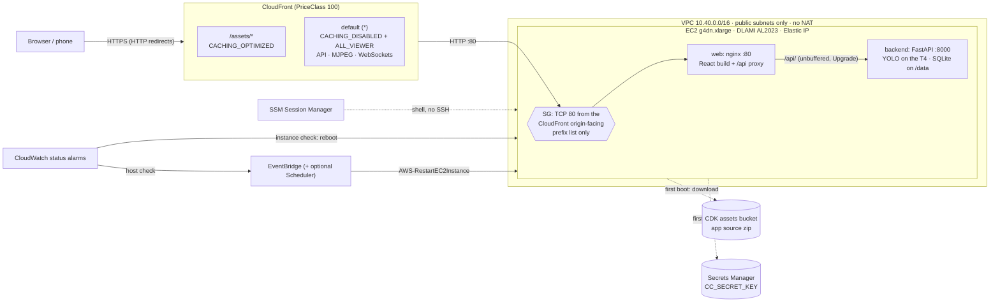

# Deploying the public demo to AWS

This deploys CrowdCounting as a public, no-login demo on one NVIDIA GPU instance behind
CloudFront. It's an AWS CDK v2 app in Python under [`infra/`](../infra), managed with `uv`.
Viewers get HTTPS on the default `*.cloudfront.net` domain, which is enough for live MJPEG
video, WebSockets, and publishing from a phone camera (browsers only allow camera access on
secure origins).

- **Region:** us-east-1
- **Compute:** one `g4dn.xlarge` (4 vCPU, 16 GiB, 1x NVIDIA T4 16 GB), x86_64
- **Cost:** about $395/month running 24/7, or about $250/month with the optional nightly
  stop. See [Cost estimate](#cost-estimate).

## Architecture



### Request path

1. The viewer opens `https://<id>.cloudfront.net`. Plain HTTP gets a redirect to HTTPS.
2. CloudFront terminates TLS with its default certificate and picks a behavior:
   - `/assets/*` (Vite's content-hashed JS/CSS) is cached at the edge (`CACHING_OPTIMIZED`,
     compressed).
   - Everything else (`index.html`, `/api/*` JSON, the MJPEG streams under `/api/`, and the
     `/api/ws/live` and `/api/publish/<token>` WebSockets) uses `CACHING_DISABLED` with the
     `ALL_VIEWER` origin request policy, so all headers, cookies, query strings and methods
     reach the origin untouched. CloudFront passes WebSocket upgrades through on any
     behavior.
3. CloudFront connects to the origin over **HTTP on port 80**, using the Elastic IP's EC2
   public DNS name (`ec2-a-b-c-d.compute-1.amazonaws.com`). The origin read timeout is 60 s,
   the most allowed without a quota increase. It limits the gap between bytes, not how long
   a response lasts, so continuous MJPEG and WebSocket traffic is fine.
4. The instance's security group only admits TCP 80 from the AWS-managed prefix list
   `com.amazonaws.global.cloudfront.origin-facing`. Nothing else can reach the instance.
5. On the instance, the `web` container (nginx, published on host port 80 by
   `docker-compose.gpu.yml`) serves the React build and proxies `/api/` to
   `backend:8000`. Buffering is off, which MJPEG needs, and `Upgrade` headers are passed
   through for WebSockets.
6. The `backend` container (FastAPI with Ultralytics YOLO on the T4) runs one inference
   thread per camera and stores data in SQLite on the `data` Docker volume.

The backend keeps per-camera worker threads and in-memory state, so it runs as exactly one
instance by design. See [Path to production](#path-to-production) for how to scale it out.

## Resources and why each one exists

All resources are tagged `Project=CrowdCounting`.

| Resource | Why |
|---|---|
| **VPC**, 2 public /24 subnets (2 AZs), internet gateway, **no NAT gateway** | The instance needs a public IP for outbound traffic (image builds, model weights, demo videos, SSM). A NAT gateway would cost about $33/month for nothing. The default security group is stripped of all rules. |
| **Custom resource** (`AwsCustomResource` → `EC2:DescribeManagedPrefixLists`) | Looks up the CloudFront origin-facing prefix-list id at deploy time. The id differs per account, and a synth-time lookup would need AWS credentials. Runs on a small CDK-managed Lambda function. |
| **Security group** | Inbound: TCP 80 from the CloudFront prefix list only. No port 22. Outbound: all. A prefix-list reference counts as its maximum size (about 55 entries) against the 60-rules-per-group quota, so it has to be the only inbound rule. |
| **EC2 instance** `g4dn.xlarge` | The AWS Deep Learning Base OSS NVIDIA Driver GPU AMI (Amazon Linux 2023), with the NVIDIA driver, Docker and nvidia-container-toolkit preinstalled. CloudFormation resolves the AMI at deploy time from the SSM parameter `/aws/service/deeplearning/ami/x86_64/base-oss-nvidia-driver-gpu-amazon-linux-2023/latest/ami-id`. 100 GB gp3 encrypted root volume (the CUDA build of the backend image alone is several GB). IMDSv2 required, with a hop limit of 1. No key pair. |
| **IAM role + instance profile** | `AmazonSSMManagedInstanceCore` for Session Manager, read access to the app-source asset, and read access to the one secret. |
| **Elastic IP** | A stable origin. An instance's own public IP changes on every stop/start and replacement, and CloudFront needs a fixed DNS name. The EIP is moved to a new instance only after the new instance reports healthy. |
| **S3 asset** (in the CDK bootstrap bucket) | The repo's `backend/`, `frontend/` and `docker-compose*.yml`, zipped by `cdk deploy`. This means no container registry and no push to GitHub. Excluded: `.git`, `node_modules`, `.venv`, `infra/`, `docs/`, local databases, `data/`, `models/`, tests, and the local dev TLS key. |
| **Secrets Manager secret** | A random 64-character `CC_SECRET_KEY`, read once by the instance at first boot. |
| **CloudFront distribution** | HTTPS for viewers (needed for phone cameras), edge caching for static assets, and a single public entry point, so the instance itself is never directly reachable. PriceClass 100 covers North America and Europe edges. |
| **2 CloudWatch alarms** | `StatusCheckFailed_Instance` reboots the instance. `StatusCheckFailed_System` triggers an EventBridge rule that runs the AWS-owned `AWS-RestartEC2Instance` runbook (stop, then start), which moves the instance to healthy hardware. EC2's built-in CloudWatch *recover* action can't be used: it isn't supported on g4dn, because g4dn has NVMe instance-store volumes. |
| **EventBridge rule + IAM role** | Connects the host-check alarm to the restart runbook. The role can only start that runbook and stop/start this one instance. |
| **EventBridge Scheduler pair** (optional, off by default) | Stops the instance nightly and starts it every morning. Turn it on with `-c crowdcounting:schedule=true`. |

### Boot sequence (user data)

`infra/crowdcounting_infra/bootstrap.sh` runs once, on the instance's first boot:

1. It installs `aws-cfn-bootstrap` and `unzip` if they're missing. It also installs the Docker
   **buildx** plugin (if missing or older than 0.17) and the **compose** plugin (if missing).
   Compose v2 builds through buildx, and the Dockerfiles use BuildKit cache mounts.
2. It registers the NVIDIA runtime with Docker (`nvidia-ctk runtime configure`) and checks the
   driver. The backend's PyTorch wheels need driver ≥ 580 (see
   [GPU notes](#gpu-notes-cuda-in-backenduvlock)). If there's no GPU or the driver is too
   old, it writes `CC_DEVICE=cpu` and logs a warning, so the demo still comes up.
3. It downloads and unzips the app to `/opt/crowdcounting`, reads the secret, and writes
   `/opt/crowdcounting/.env` (mode 600):
   `CC_SECRET_KEY`, `CC_DEMO_MODE=true`, `CC_STREAM_FPS=8`, `CC_DEMO_VIDEO_DIR=/data/demo-videos`,
   `CC_DEVICE=cuda:0`, `CC_DETECTOR=ultralytics`, `CC_COOKIE_SECURE=true`.
4. It runs `docker compose -f docker-compose.yml -f docker-compose.gpu.yml up -d --build`.
5. It waits up to 15 minutes for `http://localhost/api/health` (through nginx) and then reports
   success or failure to CloudFormation with `cfn-signal`. CloudFormation waits up to
   45 minutes for that signal.

`docker-compose.gpu.yml` gives the backend the GPU (`deploy.resources.reservations.devices`),
passes the whole `.env` to the backend container (`env_file`, so new `CC_*` settings need no
change to `docker-compose.yml`), and publishes `web` on host port 80 instead of 8080. Both
containers use `restart: unless-stopped`, so they come back after a reboot or a scheduled
stop/start.

## Prerequisites

- **GPU quota.** The account needs a vCPU quota of at least **4** for **"Running On-Demand G
  and VT instances"** (Service Quotas, EC2, quota code **`L-DB2E81BA`**) in us-east-1. New
  accounts often have 0. Request the increase before deploying (it can take a day):

  ```bash
  aws service-quotas request-service-quota-increase --region us-east-1 \
    --service-code ec2 --quota-code L-DB2E81BA --desired-value 4 --profile <p>
  ```

- **Permissions.** The deploying identity, and any organization SCPs or permission
  boundaries above it, must allow these in us-east-1, plus the global services CloudFront
  and IAM:
  - **CloudFormation**: create, update and delete stacks and change sets.
  - **EC2/VPC**: VPC, subnets, route tables, internet gateway, security groups and rules,
    `RunInstances`/`TerminateInstances`, `Describe*` including images and managed prefix
    lists, Elastic IPs, and stop/start.
  - **SSM**: `GetParameters` (for the AMI parameter), and Session Manager for access.
  - **S3**: the CDK assets bucket.
  - **Secrets Manager**: create, read and delete a secret.
  - **CloudFront**: create, update and delete a distribution.
  - **IAM**: create roles, policies and instance profiles, and `iam:PassRole`.
  - **EventBridge and EventBridge Scheduler**: rules and schedules.
  - **CloudWatch**: alarms.
  - **Lambda and CloudWatch Logs**: the custom-resource provider function.
  - **STS**: assuming the CDK bootstrap roles.

  An SCP that denies CloudFormation, or EC2 VPC, security-group or image calls, blocks this
  deployment no matter what IAM permissions the user has.
- **CDK bootstrap**, once per account and region (`npx aws-cdk@2 bootstrap`, below). It
  creates the `CDKToolkit` stack: the assets bucket and the deploy roles.
- **Local tools:** [uv](https://docs.astral.sh/uv/), Node.js 22+ (for `npx aws-cdk@2`),
  AWS CLI v2, and the [Session Manager plugin](https://docs.aws.amazon.com/systems-manager/latest/userguide/session-manager-working-with-install-plugin.html)
  for shell access. Docker isn't needed locally: images are built on the instance.

## Deploy

```bash
cd infra
uv sync
npx aws-cdk@2 synth --quiet                   # offline; runs the cdk-nag AwsSolutions checks
npx aws-cdk@2 bootstrap --profile <p>         # once per account/region
npx aws-cdk@2 deploy --profile <p>
```

The first deploy takes about 20–30 minutes. Most of that is the instance building the
backend image, which pulls about 3 GB of CUDA wheels. CloudFront deploys in parallel. When it
finishes, the stack prints these outputs:

| Output | |
|---|---|
| `Url` | `https://<id>.cloudfront.net`, the demo |
| `InstanceId` | |
| `SsmSessionCommand` | `aws ssm start-session --target i-… --region us-east-1` |
| `SecretArn` | Where `CC_SECRET_KEY` lives |

The live wall fills in over the first minute or two after boot, as the demo seeder downloads
and trims each scenario video.

### Options (CDK context)

Pass these with `-c key=value`, or set them in `infra/cdk.json`:

| Key | Default | |
|---|---|---|
| `crowdcounting:schedule` | `false` | `true` adds the nightly stop / morning start schedules |
| `crowdcounting:stopCron` / `startCron` | `cron(0 23 * * ? *)` / `cron(0 8 * * ? *)` | EventBridge Scheduler expressions |
| `crowdcounting:timezone` | `America/New_York` | Time zone for those expressions |
| `crowdcounting:availabilityZones` | (first 2 in the account) | e.g. `us-east-1b,us-east-1c`. The instance goes in the first one. Use this if launch fails with *"…g4dn.xlarge is not supported in your requested Availability Zone"* or *InsufficientInstanceCapacity*. |
| `crowdcounting:amiId` | (latest DLAMI) | Pin an AMI id so a new DLAMI release doesn't replace the instance |

### Operating it

```bash
aws ssm start-session --target <InstanceId> --region us-east-1 --profile <p>
sudo tail -f /var/log/cloud-init-output.log                      # first-boot log
cd /opt/crowdcounting && sudo docker compose -f docker-compose.yml -f docker-compose.gpu.yml ps
sudo docker compose -f docker-compose.yml -f docker-compose.gpu.yml logs -f backend
nvidia-smi                                                       # GPU in use?
```

If the first boot fails, CloudFormation rolls back and deletes the instance. To keep a failed
instance around for debugging, deploy with `--no-rollback`.

## Updating

Make your changes in the repo, then run `npx aws-cdk@2 deploy --profile <p>` again. Any change
to the included files changes the asset hash. The asset hash is part of the user data, so the
deploy replaces the instance (immutable deploys):

1. CloudFormation launches a new instance, which builds and starts the app.
2. Once the new instance's health check passes, the Elastic IP moves to it. CloudFront is not
   touched, because its origin name stays the same.
3. The old instance is terminated.

Expect a few seconds of dropped streams at the switch. **Demo data does not carry over**: the
database lives on the instance and is reseeded on boot, which is the intent for a demo. A
newer DLAMI behind the SSM parameter also triggers a replacement on the next deploy, unless
you pin `crowdcounting:amiId`.

Use `npx aws-cdk@2 diff` to preview changes first. The deploy uploads your **working tree**
(uncommitted changes included), not a git commit.

## Tearing down

```bash
cd infra && npx aws-cdk@2 destroy --profile <p>
```

This removes everything in the stack. The secret goes into Secrets Manager's default 30-day
recovery window. To delete it right away, run
`aws secretsmanager delete-secret --secret-id <SecretArn> --force-delete-without-recovery`.
The `CDKToolkit` bootstrap stack and its assets bucket stay. Delete them separately (empty the
bucket first) if nothing else in the account uses CDK.

## Cost estimate

These are us-east-1 on-demand list prices as of late 2026. Check the
[AWS Pricing Calculator](https://calculator.aws/) before relying on them.

| Item | Always on | With nightly stop (15 h/day) |
|---|---:|---:|
| EC2 `g4dn.xlarge`: $0.526/h × 730 h | $384 | ~$240 |
| EBS gp3 100 GB: $0.08/GB-month (baseline 3,000 IOPS / 125 MB/s included) | $8 | $8 |
| Public IPv4 (Elastic IP): $0.005/h, also charged while stopped | $3.65 | $3.65 |
| Secrets Manager: 1 secret | $0.40 | $0.40 |
| CloudWatch: 2 alarms, Lambda custom resource, Scheduler, S3 asset | < $1 | < $1 |
| CloudFront: see below | $0 within free tier | $0 within free tier |
| **Total** | **≈ $397/month** | **≈ $253/month** |

**CloudFront egress** is the cost that varies with usage. The live wall streams every
camera's 480 px frames over one WebSocket. Measured locally at about 4.5 FPS, those tiles
were **20–100 KB per frame** (92–443 KB/s per camera; the detailed plaza is the largest).
The enlarged view adds one full 960 px stream at 60–350 KB per frame
([architecture.md](architecture.md#performance-and-capacity)). At the demo's 8 FPS cap:

- One person watching the seven-camera wall uses about **2 MB/s, roughly 7 GB per hour**.
- 20 visitors × 15 minutes a day on the wall comes to about 1 TB a month.

CloudFront's always-free tier covers the first **1 TB/month** of egress and 10 million
requests. After that, egress to North America and Europe costs about $0.085/GB (≈ $85 per
extra TB). Origin traffic from EC2 to CloudFront is free, and so is inbound traffic such as
phone publishing. To control egress: lower `CC_STREAM_FPS` (bandwidth scales linearly with
it) or `CC_JPEG_QUALITY`, and keep the nightly stop enabled.

Spot pricing for g4dn.xlarge is usually 60–70% cheaper, but a Spot interruption would take
the demo down. Moving to Spot is a small change if that's acceptable.

## Security model

- **No SSH.** There's no key pair and no port 22. Shell access is through SSM Session
  Manager, which IAM authenticates and CloudTrail logs.
- **Origin closed to the internet.** The only inbound rule is TCP 80 from CloudFront's
  origin-facing prefix list. The VPC has no other workloads. The default security group has
  no rules.
- **Encryption.** Viewers get HTTPS through CloudFront's default certificate, and plain HTTP
  is redirected. The default certificate can't enforce a minimum TLS version (CFR4 below). The hop from CloudFront to the origin is plain HTTP
  over AWS's network (acknowledged trade-off, see cdk-nag below). The root EBS volume is
  encrypted.
- **IMDSv2 required, hop limit 1.** Instance credentials need a session token, which a
  server-side request forgery (SSRF) GET can't obtain. The token response can't cross the
  Docker bridge, so containers can't read the instance role's credentials at all.
- **Least-privilege instance role.** Session Manager core, read on one S3 asset prefix, and
  read on one secret.
- **Secrets.** `CC_SECRET_KEY` is generated by Secrets Manager. It's written only to a
  root-only `.env` on the instance and is never echoed to the boot log. It isn't rotated,
  because rotating it would invalidate sessions and stored camera passwords.
- **Demo-mode restrictions** (`CC_DEMO_MODE=true`):
  - There's no login: every visitor is the shared demo user.
  - The scenario cameras come from bundled sample videos.
  - Visitors can only add *browser* (phone/laptop) cameras, capped at
    `CC_DEMO_MAX_BROWSER_CAMERAS`. The server therefore never opens a URL, file or ONVIF
    address a visitor typed in, which closes the SSRF path described in the README's
    security notes. Everything visitors do is visible to other visitors, and the data resets
    on every redeploy.
- **Licensing.** Ultralytics YOLO is AGPL-3.0, and a public demo is a network service. See
  the README's licensing note. `CC_DETECTOR=rfdetr` (Apache-2.0) avoids the issue.

### cdk-nag

`cdk synth` runs `cdk_nag.AwsSolutionsChecks` through `Validations.of(app)`. Any finding that
hasn't been acknowledged fails the synth. These findings are acknowledged in
`infra/crowdcounting_infra/stack.py` as deliberate demo trade-offs, each with its reason:

| Rule | Where | Why it's accepted |
|---|---|---|
| IAM4 | Instance role | `AmazonSSMManagedInstanceCore` is the AWS-maintained policy for Session Manager |
| IAM4 | CDK custom-resource Lambda | `AWSLambdaBasicExecutionRole` (its own logs only) |
| IAM5 | Instance role | `Asset.grant_read` wildcards on the CDK assets bucket (read only) |
| IAM5 | Custom resource, restart role | `DescribeManagedPrefixLists` / `DescribeInstances` / `DescribeInstanceStatus` have no resource-level permissions. Also allows any version of the AWS-owned restart runbook. |
| SMG4 | Secret | Not rotated (see above) |
| EC28 | Instance | Basic monitoring is enough; the status-check metrics are already at 1 minute |
| EC29 | Instance | Termination protection would block immutable replacement |
| VPC7 | VPC | No flow logs for a single-instance demo |
| CFR1 | Distribution | Public demo, no geo restriction |
| CFR2 | Distribution | No WAF (cost). Add for production. |
| CFR3 | Distribution | No access logs (cost and volume from streams) |
| CFR4 | Distribution | The default certificate can't set a minimum TLS version. A custom domain + ACM can. |
| CFR5 | Distribution | HTTP origin, locked to CloudFront by the security group |

## GPU notes: CUDA in `backend/uv.lock`

`backend/uv.lock` pins `torch 2.14.1`. The PyPI wheel `torch-2.14.1-cp312-cp312-manylinux_2_28_x86_64.whl`
pulls CUDA on Linux (`sys_platform == 'linux'` markers):

- `cuda-toolkit 13.0.3` with cuBLAS, cuDNN, cuFFT and the other CUDA libraries, plus
  `nvidia-cudnn-cu13`, `nvidia-nccl-cu13`, `nvidia-cusparselt-cu13`, `nvidia-nvshmem-cu13`,
  `nvidia-cuda-runtime 13.0.96`, and `triton`.

The backend image built on the instance is therefore CUDA-enabled, and no backend change is
needed. Two caveats:

- **Driver ≥ 580.** CUDA 13 user-space libraries need NVIDIA driver **580 or newer**. Current
  releases of the DLAMI Base OSS NVIDIA Driver AMI should ship a 580-series driver, but this
  hasn't been checked on a live instance. An older or pinned AMI might not, in which case the bootstrap falls back to `CC_DEVICE=cpu` and logs a warning.
  Check with `nvidia-smi` on the instance. If you need an older driver, rebuild the backend
  against CUDA 12 wheels (the PyTorch `cu126`/`cu128` index) instead.
- **The T4 is Turing (sm_75).** That's still supported by CUDA 13, which dropped Maxwell,
  Pascal and Volta.

## Path to production

This stack is shaped for a cheap, always-reachable demo. For a real multi-tenant service:

1. **Split the API from the vision workers.** Run the FastAPI API as a stateless service
   (ECS Fargate behind an ALB). Move camera workers to a separate GPU worker tier that claims
   cameras from a queue or lease table and publishes frames and counts. Stream video through
   a media path (for example, WebRTC/HLS through a media server, or Kinesis Video Streams)
   instead of MJPEG through the API.
2. **Use RDS for PostgreSQL** (or Aurora) instead of SQLite. The backend already supports
   `CC_DATABASE_URL=postgresql+psycopg://…`.
3. **Autoscale the GPU workers** on ECS with an EC2 GPU capacity provider (g4dn/g5/g6), scaled
   on cameras per GPU. Store images in ECR and build them in CI instead of on the instance.
4. **Send alerts through SNS and EventBridge**, publishing occupancy and incident events so
   email, SMS, webhooks and downstream automations can subscribe.
5. **Add Cognito** user pools for sign-up and sign-in (with MFA) instead of the demo user,
   keeping per-owner scoping in the API.
6. **Put AWS WAF on CloudFront**: managed rule groups plus rate limiting on `/api/`. Add a
   custom domain with an ACM certificate (TLS 1.2+ minimum) and CloudFront access logs.
   Consider a VPC origin, so the instances have no public IP at all.
7. **Operations:** VPC flow logs, CloudWatch agent logs and metrics from containers, backups
   (RDS snapshots), and secret rotation with a key-versioning scheme for stored camera
   passwords.
